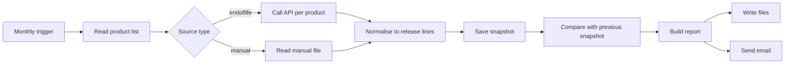
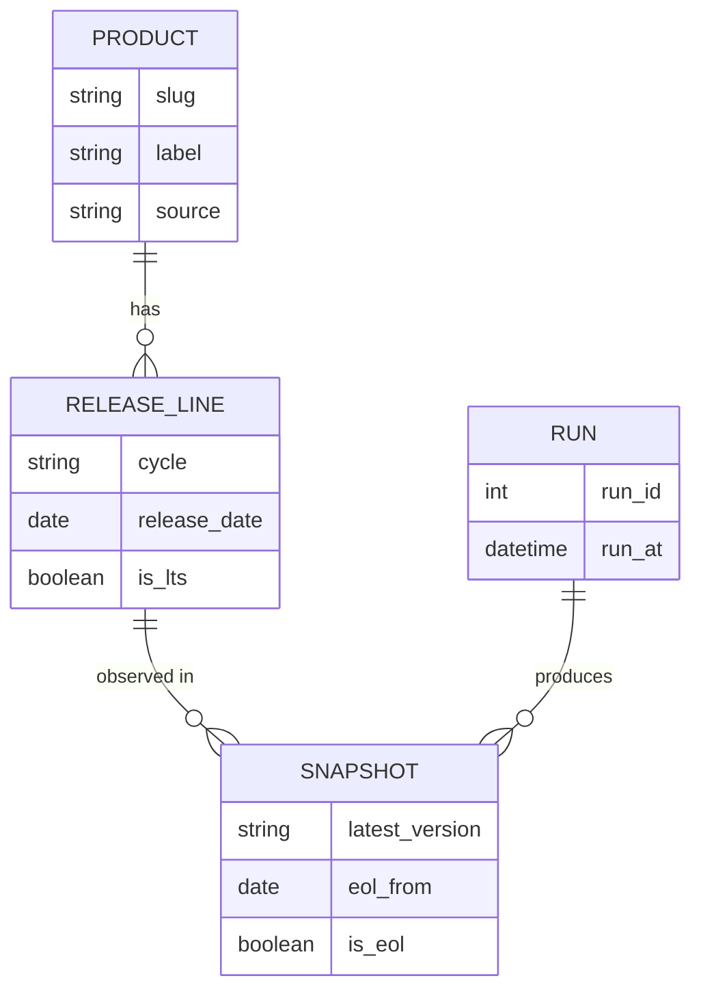
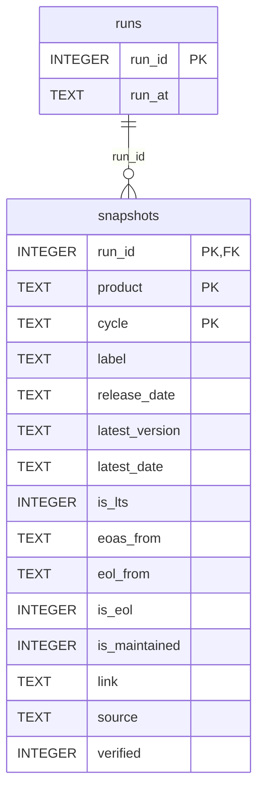
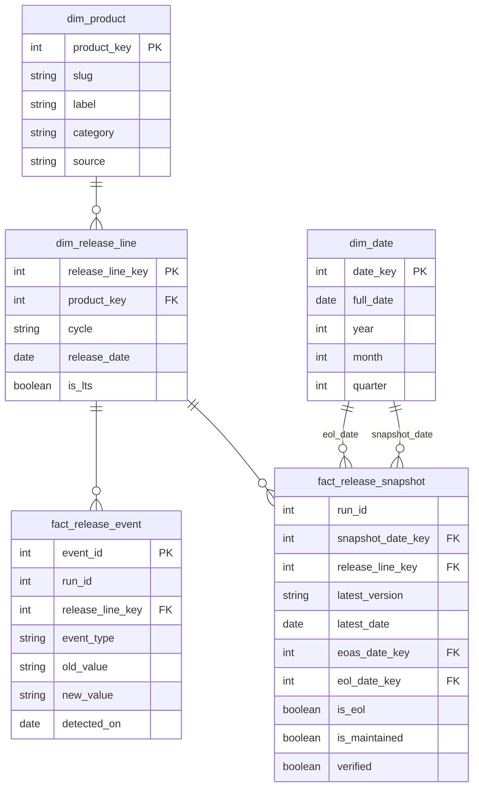
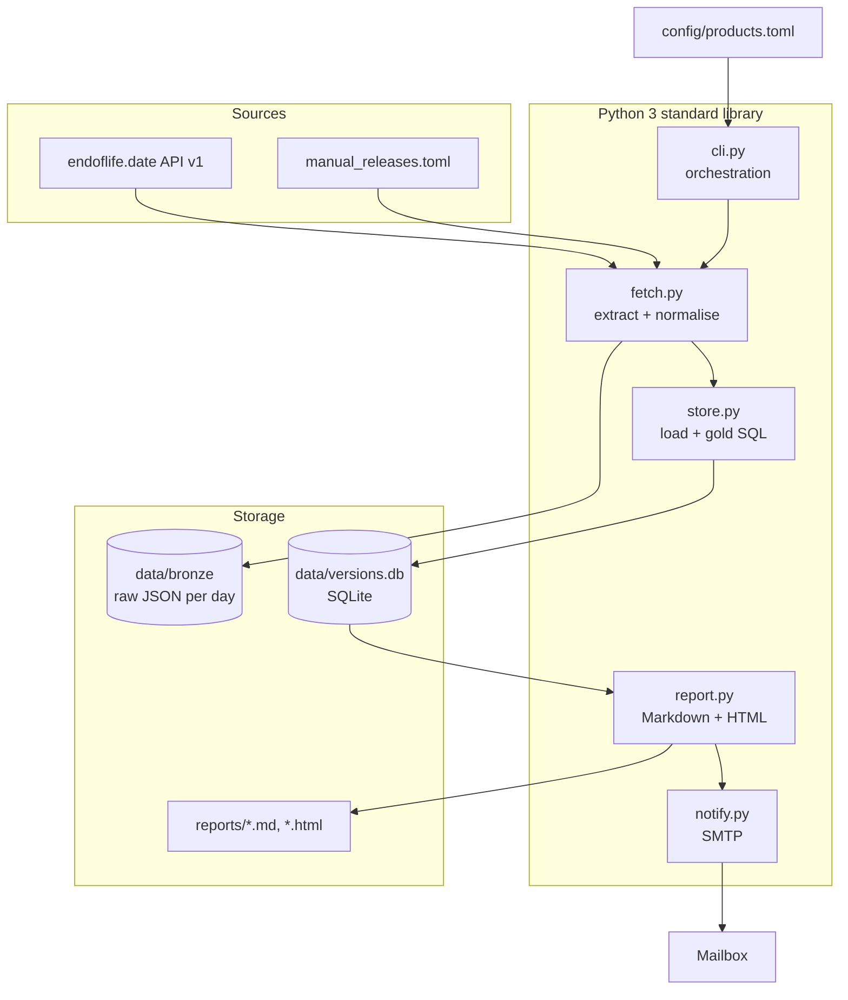
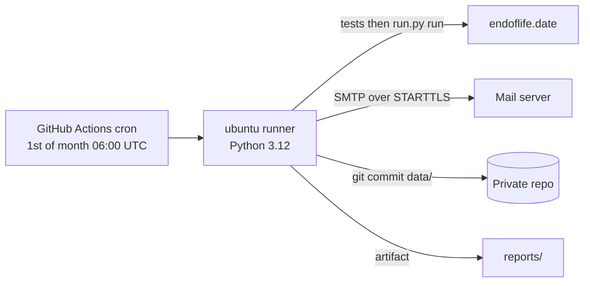

# tech-version-watch – Data model, functional and technical architecture

Status legend: **[Built]** = exists in the code today. **[Target]** = proposed evolution, not implemented.

---

## 1. Functional architecture

### 1.1 Purpose
Give one engineer a monthly, automatic answer to: *"Which versions of my technologies were released, which ones are no longer supported, and when will the ones I use stop being supported?"*

### 1.2 Actors
| Actor | Role |
|---|---|
| Engineer (you) | Chooses the technologies, reads the monthly report, maintains manual data. |
| Scheduler | Starts the pipeline once a month (GitHub Actions or Windows Task Scheduler). |
| Source systems | endoflife.date API (automatic), vendor lifecycle pages (manual, e.g. Talend). |
| Mail server | Delivers the report (SMTP). |

### 1.3 Use cases
| ID | Use case | Result |
|---|---|---|
| UC1 | Configure tracked technologies | `config/products.toml` lists product slug, label, source. |
| UC2 | Collect release data | One row per release line (e.g. Java 21, Mule 4.9-lts). |
| UC3 | Detect changes since last run | New line, new latest version, newly end-of-life, changed end-of-life date. |
| UC4 | Warn about upcoming end of life | Supported lines ending within N days (default 180). |
| UC5 | Receive the report | HTML + Markdown report by email and on disk. |
| UC6 | Maintain products not covered by the API | `config/manual_releases.toml`, flagged "unverified" until confirmed. |

### 1.4 Business rules
- A **release line** (cycle) is one supported series: `Java 21`, `Mule 4.10`, `Python 3.12`.
- **Latest version** = newest patch/minor published inside that line.
- **End of standard support (EOAS)** comes before **end of life (EOL)**. EOL = no more security fixes.
- A line is "upcoming EOL" when `is_eol = 0` and `eol_from` falls between today and today + N days.
- A line is "newly EOL" when it is EOL now and was not EOL in the previous run.
- A **new version** is any change of `latest_version` for a line that existed in the previous run.
- The first run is a **baseline**: it saves data and reports no differences.
- A failed source never blocks the run; it is listed in the report.
- Manual data with `verified = false` is always labelled "(unverified)".

### 1.5 Functional flow

### 1.6 Report content (functional view)
1. New release lines
2. New versions (previous -> new)
3. Newly end-of-life
4. Changed end-of-life dates
5. Upcoming end of life (next N days)
6. Recently reached end of life (last 60 days)
7. Currently supported versions
8. Sources that failed

---

## 2. Data modeling

### 2.1 Conceptual model

A product has many release lines; each run observes every release line once.

### 2.2 Physical model **[Built]** – SQLite, append-only snapshots

Grain of `snapshots`: **one row per product, release line and run**. Nothing is updated or deleted, so history is kept and every month can be compared with any earlier month (similar to a type-2 history, but by run instead of by validity dates).

### 2.3 Data dictionary **[Built]**
| Column | Type | Meaning | Example |
|---|---|---|---|
| run_id | int | Pipeline execution id | 3 |
| product | text | API slug, stable key | `mulesoft-runtime` |
| label | text | Display name | MuleSoft Mule Runtime |
| cycle | text | Release line | `4.12` |
| release_date | text (ISO date) | First release of the line | 2026-06-30 |
| latest_version | text | Newest version in the line | `4.12.1` |
| latest_date | text (ISO date) | Date of that version | 2026-07-15 |
| is_lts | 0/1 | Long-term-support line | 0 |
| eoas_from | text (ISO date) | End of standard support | 2026-11-30 |
| eol_from | text (ISO date) | End of life (null = not announced) | 2027-02-28 |
| is_eol | 0/1 | Already past end of life | 0 |
| is_maintained | 0/1 | Still receiving fixes | 1 |
| link | text | Release notes URL | docs link |
| source | text | `endoflife.date` or `manual` | manual |
| verified | 0/1 | 0 for unconfirmed manual data | 0 |

Primary key `(run_id, product, cycle)`. ISO dates are stored as text, so string comparison orders them correctly in SQLite.

### 2.4 Gold queries **[Built]** (in `store.py`)
| Query | Logic |
|---|---|
| new_cycles | Rows of the current run with no match on `(product, cycle)` in the previous run, only for products present in both runs. |
| new_latest_versions | Same `(product, cycle)` in both runs and `latest_version` differs. |
| eol_date_changes | Same line in both runs and `eol_from IS NOT` the previous value (null-safe). |
| newly_eol | Current `is_eol = 1` and previous `is_eol = 0`. |
| upcoming_eol | `is_eol = 0` and `eol_from BETWEEN today AND today + N days`. |
| recently_eol | `is_eol = 1` and `eol_from >= today - 60 days`. |
| supported_now | `is_eol = 0` ordered by product and release date. |

### 2.5 Data quality rules
| Rule | State |
|---|---|
| Primary key prevents duplicate `(run_id, product, cycle)` | **[Built]** |
| Source name and verified flag mandatory | **[Built]** |
| Per-product failure isolation and listing in the report | **[Built]** |
| Dates must be valid ISO dates; latest version not empty for supported lines | **[Target]** |
| Alert if a product returns far fewer lines than in the previous run | **[Target]** |

### 2.6 Target dimensional model **[Target]**
Useful if you move to a warehouse (DuckDB, free cloud tier) with a dashboard.

`event_type` values: `NEW_LINE`, `NEW_VERSION`, `EOL_REACHED`, `EOL_DATE_CHANGED`. Persisting the events (instead of recomputing them each time) gives a time series for dashboards, such as "how many versions per year does each product release".

---

## 3. Technical architecture

### 3.1 Component view **[Built]**

### 3.2 Modules
| Module | Responsibility |
|---|---|
| `cli.py` | Orchestrates: load config, loop over products with error isolation, store, report, email. Exit code 1 if no data. |
| `fetch.py` | HTTP call (`urllib`, User-Agent set, 30 s timeout), normalisation of `releases[]` to rows, manual TOML loader. |
| `store.py` | Schema creation, run creation, bulk insert (`INSERT OR REPLACE`), the gold queries. |
| `report.py` | Builds the context, renders Markdown and HTML (HTML-escaped). |
| `notify.py` | Sends multipart email over STARTTLS; reads credentials from environment variables only. |

### 3.3 Medallion layering
| Layer | Technology | Content |
|---|---|---|
| Bronze | Files `data/bronze/<date>/<slug>.json` | Raw, unmodified API responses (replayable). |
| Silver | SQLite `snapshots` | Cleaned, typed, one row per line per run. |
| Gold | SQL queries in `store.py` | Business views used by the report. |

### 3.4 Technology choices
| Need | Choice | Why |
|---|---|---|
| Language | Python 3.14 locally, 3.12 in CI | Required skill, `tomllib` and `sqlite3` built in. |
| Storage | SQLite | Zero setup, one file, enough for a few thousand rows. |
| Config | TOML | Readable, parsed by the standard library. |
| API | endoflife.date | Free, no key, gives EOL dates. |
| Email | `smtplib` + Gmail app password | Free, no extra service. |
| Scheduling | GitHub Actions cron (or Task Scheduler) | Free; works while your PC is off. |
| Tests | `unittest` | No dependency, 8 offline tests. |

### 3.5 Deployment and scheduling

Alternative: Windows Task Scheduler runs `scripts/run_monthly.ps1` on your PC with a monthly trigger.

### 3.6 Configuration and secrets
| Item | Where |
|---|---|
| Technologies | `config/products.toml` |
| Manual releases | `config/manual_releases.toml` |
| `SMTP_HOST`, `SMTP_PORT`, `SMTP_USER`, `SMTP_PASSWORD`, `MAIL_TO`, `MAIL_FROM` | Environment variables locally, repository secrets in GitHub. Never in the code or in git. |
| CLI options | `--days`, `--db`, `--out`, `--no-email` |

### 3.7 Non-functional requirements
| Topic | Design |
|---|---|
| Reliability | Per-source try/except; the report lists failed sources; exit code 1 only when nothing was fetched. |
| Idempotence | Re-running creates a new run id; reports are named by date and overwritten the same day. |
| Reproducibility | Raw payloads kept in bronze, so any run can be rebuilt. |
| Security | Secrets via environment; HTML output escaped; read-only public API; private repo advised for `data/`. |
| Performance | About 8 HTTP calls per month; runtime a few seconds. |
| Cost | Zero: free API, free SMTP account, free CI minutes. |
| Maintainability | Small modules, tests for every gold query, config separated from code. |
| Observability | Console log per product (`[ok]` / `[fail]`), local log file with Task Scheduler. |

### 3.8 Known limits and risks
- The report is only as accurate as endoflife.date; if the API changes its schema, `normalize_endoflife` must be updated.
- Talend data is manual and currently unverified.
- A run that fetches a product partially could create false "new version" noise; the target data-quality check on row counts addresses this.
- Gmail may require an app password and can block sign-ins from new locations; test the email once from your machine.
- SQLite in git creates binary commits; fine for this size, replace with a warehouse if it grows.

### 3.9 Evolution roadmap **[Target]**
1. Data-quality checks before loading (ISO dates, non-empty latest version, row-count guard).
2. Persist `fact_release_event` and load the dimensional model into DuckDB.
3. Second source type: GitHub Releases for tools not in endoflife.date.
4. Dashboard (Streamlit or Power BI) on the snapshots and events.
5. Alert rule: weekly check that emails only when an EOL date is within 90 days.
